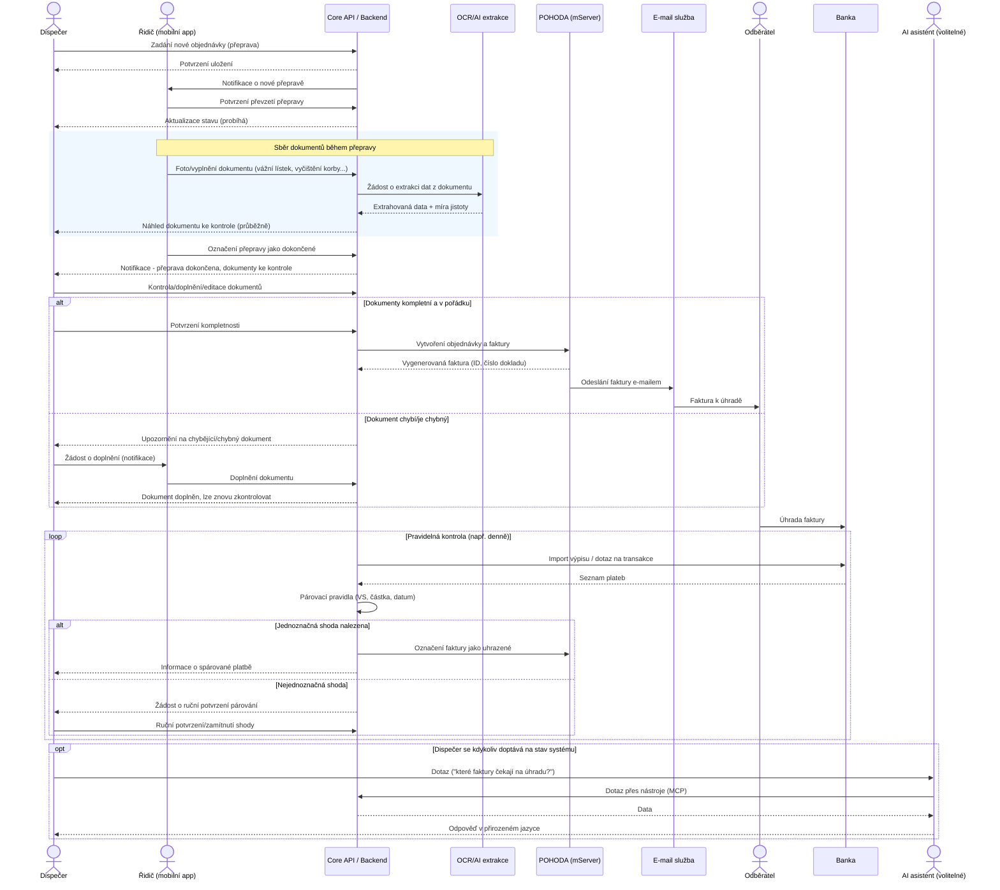

# Implementační plán – IT systém KAROLINA

> Navazuje na [high-level-context.md](./high-level-context.md) a předchozí architektonické zhodnocení nápadu. Tento dokument obsahuje fázový plán, odhad časové náročnosti a orientační rozpočet.

**Důležitá poznámka k přesnosti odhadů:** Jedná se o odhad typu *rozmezí* (±30–50 %) vycházející ze zkušeností s podobně velkými projekty na českém trhu. Přesnější čísla (±10–15 %) vyžadují úvodní **discovery/specifikační fázi** (viz Fáze 0), po které se odhad zpřesní na základě skutečného datového modelu, počtu uživatelů a konkrétních API (POHODA, banka).

---

## 1. Shrnutí rozsahu

| MVP | Co obsahuje | Nahrazuje z Karolininy práce |
|---|---|---|
| **MVP 1** | Web portál dispečera + mobilní app řidiče, objednávky, nahrávání dokumentů (foto/PDF), stavy přepravy | Sběr a třídění dokumentů |
| **MVP 2** | Integrace na POHODU (zápis objednávky, vystavení a odeslání faktury) | Ruční zápis do POHODY + fakturace |
| **MVP 3** | OCR/AI extrakce dat z vážních lístků a dalších dokumentů | Ruční přepis údajů z papírů |
| **MVP 4** | Napojení na bankovní výpis a automatické párování plateb s fakturami | Ruční párování plateb |
| **MVP 5 (volitelné)** | AI asistent / chat vrstva nad systémem (LangChain + MCP) | Dotazování, přehledy, hlídání výjimek |

---

## 2. Harmonogram (fázový plán)

| Fáze | Obsah | Trvání (kalendářně*) | Odhad práce (MD**) |
|---|---|---|---|
| **Fáze 0 – Discovery & specifikace** | Detailní rozhovory s Karolinou/dispečery/řidiči, datový model, UX návrh obrazovek, finální výběr integrace POHODA/banka | 2–3 týdny | 8–12 MD |
| **Fáze 1 – MVP 1** (web + mobilní app, core backend) | Autentizace, objednávky, přeprava, nahrávání dokumentů, stavy, základní dashboard | 6–8 týdnů | 50–70 MD |
| **Fáze 2 – MVP 2** (POHODA integrace) | Middleware na mServer, mapování objednávka → faktura, e-mailové odeslání | 3–4 týdny | 12–18 MD |
| **Fáze 3 – MVP 3** (OCR/AI extrakce) | Výběr OCR/vision modelu, extrakce dat z vážních lístků, validační UI pro dispečera | 4–6 týdnů | 18–25 MD |
| **Fáze 4 – MVP 4** (bankovní párování) | Import výpisu / PSD2, párovací pravidla + AI návrh shody, UI pro potvrzení | 3–4 týdny | 12–18 MD |
| **Fáze 5 – MVP 5 (volitelné)** (AI asistent) | LangChain agent, MCP server s nástroji nad API, chat UI pro dispečera | 4–6 týdnů | 18–25 MD |

\* *Při týmu cca 2 vývojářů pracujících paralelně na části úkolů; fáze se mohou částečně překrývat.*
\** *MD = člověkoden (8 hodin).*

### Celkový čas do nasazení klíčové funkcionality (Fáze 0–4)
- **Souhrnná práce:** cca 100–143 MD
- **Kalendářní doba (sekvenčně s mírným překryvem):** cca **4,5–6 měsíců**

### Včetně volitelné AI asistenční vrstvy (Fáze 0–5)
- **Souhrnná práce:** cca 118–168 MD
- **Kalendářní doba:** cca **5,5–7,5 měsíce**

---

## 3. Doporučené složení týmu

| Role | Zapojení | Poznámka |
|---|---|---|
| Fullstack vývojář (web + backend) | 1–2 osoby, plný úvazek | Jádro systému, API, integrace |
| Mobilní/frontend vývojář | 1 osoba (může být sdílená s fullstack rolí při použití React Native / PWA) | Appka pro řidiče |
| UX/UI designer | částečný úvazek, hlavně na začátku | Návrh obrazovek pro řidiče (musí být jednoduché, pro mobil, offline) |
| Projektový vedoucí / analytik | částečný úvazek po celou dobu | Komunikace s Karolinou, business logika, akceptace |
| QA / testování | částečný úvazek, zesiluje ke konci fází | Testování integrací (POHODA, banka) je kritické |

---

## 4. Rozpočet

Orientační sazby na českém trhu pro menší softwarový tým/freelancery (2026): **7 000–10 000 Kč/MD** (blended rate zahrnující vývojáře i menší podíl PM/QA). U agentury s vyšším overheadem počítejte s horní hranicí nebo výše.

| Fáze | MD (rozsah) | Kč při 7 000/MD | Kč při 10 000/MD |
|---|---|---|---|
| Fáze 0 – Discovery | 8–12 | 56 000 | 120 000 |
| Fáze 1 – MVP 1 | 50–70 | 350 000 | 700 000 |
| Fáze 2 – MVP 2 (POHODA) | 12–18 | 84 000 | 180 000 |
| Fáze 3 – MVP 3 (OCR/AI) | 18–25 | 126 000 | 250 000 |
| Fáze 4 – MVP 4 (banka) | 12–18 | 84 000 | 180 000 |
| **Mezisoučet (Fáze 0–4)** | **100–143** | **≈ 700 000 Kč** | **≈ 1 430 000 Kč** |
| Fáze 5 – AI asistent (volitelné) | 18–25 | 126 000 | 250 000 |
| **Celkem s AI asistentem** | **118–168** | **≈ 826 000 Kč** | **≈ 1 680 000 Kč** |

> K vývojovým nákladům je potřeba připočítat **rezervu na změny/vícepráce cca 10–15 %**, zejména u integrace POHODA a banky, kde se často objeví nečekané technické detaily.

---

## 5. Provozní náklady (po spuštění)

| Položka | Odhad | Poznámka |
|---|---|---|
| Hosting (server/cloud, databáze, úložiště souborů) | 2 000–6 000 Kč/měsíc | Záleží na objemu dokumentů (fotky vážních lístků) a počtu uživatelů |
| POHODA mServer / licence | 15 000–25 000 Kč/rok | Pokud firma ještě nemá odpovídající edici POHODY (mServer vyžaduje vyšší edici) |
| OCR/AI API náklady (vision model na extrakci dat) | 1 000–4 000 Kč/měsíc | Při odhadu řádově stovek dokumentů měsíčně; cena roste s objemem |
| Bankovní API (PSD2) – pokud zvoleno online napojení | 0–5 000 Kč/měsíc nebo jednorázový poplatek bance | Alternativa zdarma: pravidelný import CSV/XML výpisu bez PSD2 |
| Údržba a podpora systému | 10–15 % z vývojových nákladů ročně, nebo retainer 1–3 MD/měsíc | Opravy chyb, aktualizace, drobný rozvoj |
| AI asistent – provoz (LLM API) | 500–3 000 Kč/měsíc | Záleží na frekvenci dotazů dispečera |

**Odhad celkových ročních provozních nákladů (bez AI asistenta):** cca **40 000–100 000 Kč/rok**.

---

## 6. Rizika ovlivňující čas a rozpočet

| Riziko | Dopad | Doporučení |
|---|---|---|
| POHODA mServer vyžaduje lokální síťovou dostupnost | Prodloužení Fáze 2, nutnost VPN/on-prem komponenty | Ověřit už ve Fázi 0 konkrétní edici POHODY a síťovou topologii |
| Kvalita a variabilita papírových vážních lístků (razítka, rukopis) | Nižší přesnost OCR, více manuální kontroly | Počítat s "human-in-the-loop" validací, nespoléhat na 100% automatizaci hned od začátku |
| Offline konektivita na nakládkách/vykládkách | Nutnost offline-first appky, složitější synchronizace | Zahrnuto v odhadu Fáze 1, ale je to technicky nejnáročnější část appky |
| Adopce řidičů (věk, IT gramotnost) | Nízké využívání appky, návrat k papíru | Jednoduché UX, pilotní provoz s 2–3 řidiči před plným nasazením |
| Bankovní PSD2 certifikace/schvalování | Prodloužení Fáze 4 o týdny | Začít s jednodušším importem výpisu, PSD2 řešit až v další iteraci |

---

## 7. Doporučený další krok

1. Provést **Fázi 0 (discovery)** – i samostatně objednatelnou – která potvrdí/zpřesní rozsah a dá závaznější nabídku na Fáze 1–4.
2. Rozhodnout o **pilotním provozu** MVP 1 s omezeným počtem řidičů/objednávek dřív, než se pokračuje na POHODA/banku integraci.
3. Teprve po stabilizaci základního provozu zvážit **Fázi 5 (AI asistent)** jako nadstavbu.

---

## 8. Sekvenční diagram – celý proces přepravy

Diagram ukazuje jeden kompletní "happy path" cyklus: od zadání objednávky dispečerem, přes práci řidiče na přepravě, automatické vystavení faktury, až po spárování platby. Volitelná AI asistenční vrstva je znázorněna jako samostatná interakce (`opt` blok), protože běží paralelně/na vyžádání, mimo hlavní tok.

---

*Dokument slouží jako podklad pro rozhodnutí o dalším postupu a pro případnou poptávku u dodavatelů. Čísla jsou orientační a budou upřesněna po Fázi 0.*
